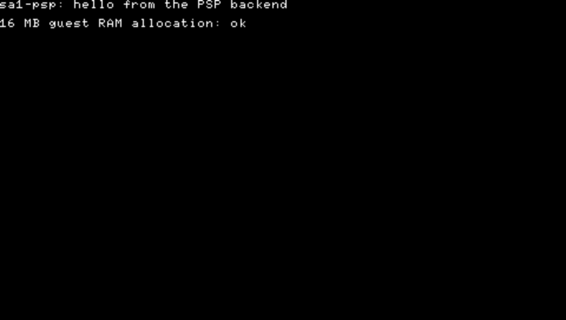

# M-1 Toolchain

Exit test (README §8): a hello-world builds for both desktop and PSP from one
CMake tree.

Status: **passed 2026-10-16.** Both hello-worlds build from the one tree;
the PSP EBOOT boots in PPSSPP (screenshot below).

## Installed (2026-10-16)

| Tool | Version | Path | How |
|---|---|---|---|
| Git | 2.55 | `C:\Program Files\Git\cmd` | before M-1 |
| CMake | 4.4.4 | `C:\Program Files\CMake\bin` | `winget install Kitware.CMake` |
| Ninja | 1.13.2 | `%LOCALAPPDATA%\Microsoft\WinGet\Packages\Ninja-build.Ninja_Microsoft.Winget.Source_8wekyb3d8bbwe` | `winget install Ninja-build.Ninja` |
| LLVM / clang | 23.1.3 | `C:\Program Files\LLVM\bin` | `winget install LLVM.LLVM` |
| VS 2022 Build Tools | 17.14 (MSVC 14.44.35207, Windows SDK 10.0.26100.0) | `C:\Program Files (x86)\Microsoft Visual Studio\2022\BuildTools` | `winget install Microsoft.VisualStudio.2022.BuildTools` with `--add Microsoft.VisualStudio.Workload.VCTools --includeRecommended` |
| PPSSPP | 1.20.4 | `C:\Program Files\PPSSPP` | `winget install PPSSPPTeam.PPSSPP` |
| WSL | 2.7.13 (kernel 6.18.33.2) | | `wsl --install -d Ubuntu --no-launch`, run by the maintainer as admin |
| Ubuntu (WSL) | 26.04.1 LTS | distro `Ubuntu`, no regular user; everything runs as root | as above |
| pspdev (pspsdk) | v20261001, psp-gcc 15.2.0 | `/opt/pspdev` in WSL; `PSPDEV=/opt/pspdev` | release tarball, see below |
| WSL build tools | cmake 4.2.3, ninja 1.13.2, build-essential 12.12 | Ubuntu packages | `apt-get` |

PATH: CMake and Git add themselves to the machine PATH, Ninja to the user
PATH. `C:\Program Files\LLVM\bin` and `C:\Program Files\PPSSPP` were added to
the **user** PATH by hand. Open a new shell to pick them up.

clang finds the MSVC headers and libraries on its own (via the VS setup
API), so no Developer Command Prompt is needed for the desktop build.

### Why WSL for the PSP SDK

pspdev publishes no native Windows build; its releases are Linux and macOS
tarballs only, and the official Windows instructions
(pspdev.github.io/installation/windows) are "install WSL, then follow
Ubuntu". The PSP build therefore runs inside WSL, on the same checkout under
`/mnt/c/...`, with the same CMake tree.

What was done differs from the pspdev page in three ways. The distro was
installed with `--no-launch`, so there is no Linux user and everything runs
as root via `wsl -d Ubuntu -u root`. The SDK lives in `/opt/pspdev`, not
`~/pspdev`. The environment is set in `/etc/profile.d/pspdev.sh`, so
`bash -l` picks it up. Ubuntu 26.04 renamed two of the listed packages:
`libreadline8` became `libreadline8t64` and `libgpgme11` became
`libgpgme45`. `ninja-build` was added so both builds use Ninja.

## Build commands

Desktop (PowerShell, from `sa1-psp\`):

```
cmake -S . -B build-desktop -G Ninja -DTARGET=desktop -DCMAKE_C_COMPILER=clang -DCMAKE_CXX_COMPILER=clang++
cmake --build build-desktop
build-desktop\backend\desktop\sa1psp_hello.exe
```

Prints `sa1-psp: hello from the desktop backend`.

PSP (WSL, from `<project-dir>/sa1-psp`, in a login
shell such as `wsl -d Ubuntu -u root -- bash -l`):

```
cmake -S . -B build-psp -G Ninja -DTARGET=psp -DCMAKE_TOOLCHAIN_FILE=$PSPDEV/psp/share/pspdev.cmake
cmake --build build-psp
```

Produces `build-psp/EBOOT.PBP`. Run it in PPSSPP (Windows):

```
PPSSPPWindows64.exe build-psp\EBOOT.PBP
```

## PSP hello-world notes

- `PSP_MODULE_INFO("SA1PSP", PSP_MODULE_USER, 0, 1)`, main thread
  `PSP_THREAD_ATTR_USER | PSP_THREAD_ATTR_VFPU`.
- Heap: current pspsdk no longer defines `PSP_HEAP_SIZE_MAX()`. A negative
  `PSP_HEAP_SIZE_KB` gives libcglue's `sbrk` all free user memory minus a
  small threshold, which is what the old macro did. The source uses the macro
  if the SDK has it, else `PSP_HEAP_SIZE_KB(-1)`.
- `create_pbp_file` defaults to `MEMSIZE=2` in PARAM.SFO, despite its own
  comment saying 1. We pass `MEMSIZE 1` so a PSP-2000 or later gets its
  extended user memory (the 52 MB of README §7).
- The hello-world mallocs 16 MB (the future guest RAM array) and prints
  whether it worked.

## WSL setup as run (root, no Linux user)

From an admin PowerShell (done by the maintainer), then reboot:

```
wsl --install -d Ubuntu --no-launch
```

Then, as root inside WSL (`wsl -d Ubuntu -u root -- bash -l`):

```
apt-get update
apt-get install -y build-essential cmake ninja-build pkgconf libarchive-tools fakeroot wget libreadline8t64 libusb-0.1-4 libgpgme45
wget -O /tmp/pspdev.tar.gz https://github.com/pspdev/pspdev/releases/download/v20261001/pspdev-ubuntu-latest-x86_64.tar.gz
echo "a86efe624e770005290919617859e9df24bd8fcd3e364f4587f23ec7364b0acd  /tmp/pspdev.tar.gz" | sha256sum -c -
tar -xf /tmp/pspdev.tar.gz -C /opt
printf 'export PSPDEV=/opt/pspdev
export PATH="$PATH:$PSPDEV/bin"
' > /etc/profile.d/pspdev.sh
```

`psp-config --pspdev-path` in a new login shell prints `/opt/pspdev`.

## Result



| Measure | Value |
|---|---|
| `build-psp/EBOOT.PBP` | 858,412 bytes (unstripped ELF 858,028 + PARAM.SFO 344; default build type, so no `psp-strip`) |
| PARAM.SFO | `TITLE=SA1 PSP`, `MEMSIZE=1`, `APP_VER=00.01`; `DISC_ID=UCJS10041` is the mksfoex default |
| 16 MB `malloc` in PPSSPP | **ok** |
| Desktop exe | prints the hello line, exit 0 |

The 16 MB allocation would also fit without `MEMSIZE=1` (a PSP-1000 has
about 24 MB of user memory). The flag only matters once the budget goes past
that, as README §7 expects. Real hardware (the test PSP-3001) is not tested
yet; README §8 puts the hardware check at M4.

PPSSPP was captured with `PrintWindow` on its window, so nothing in front of
it ends up in the image.
